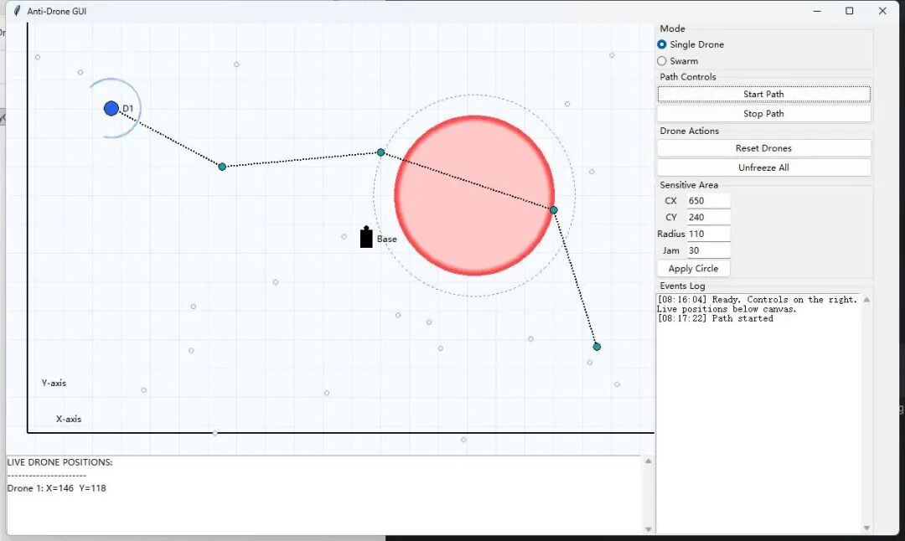
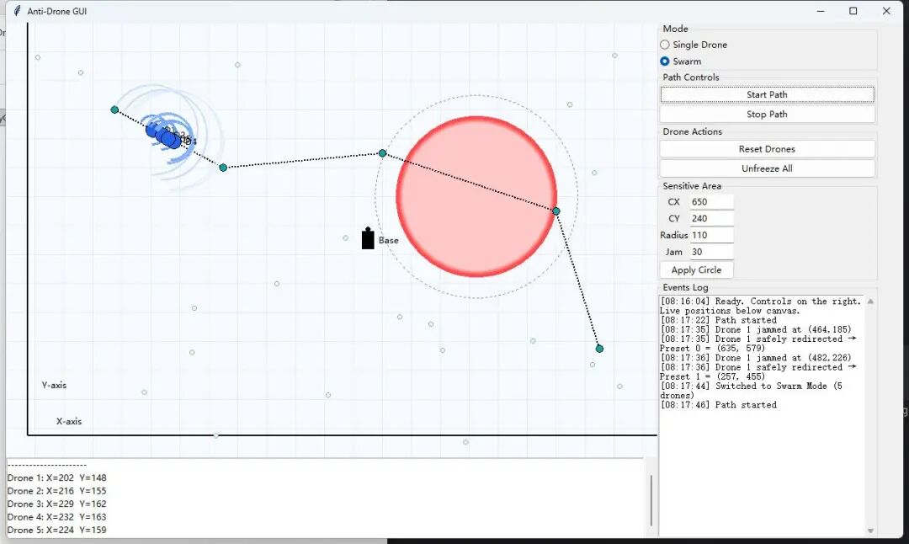
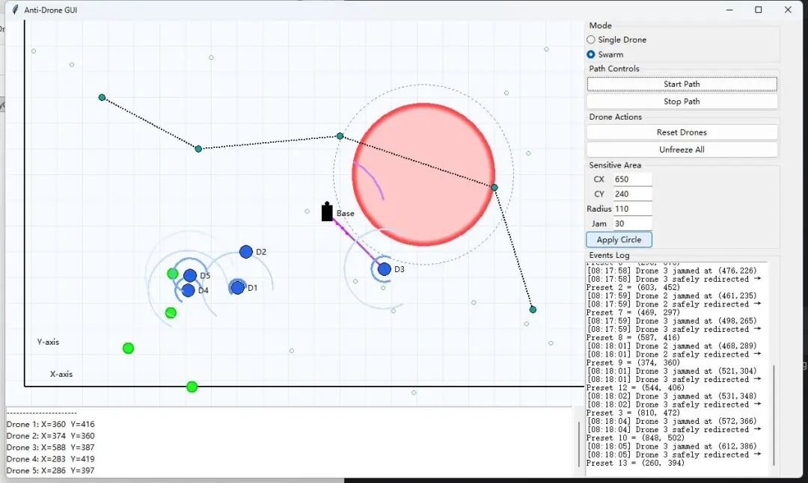

# New Line of Defense for Low-altitude Urban Safety: Research on Anti-UAV Defense System Based on Navigation Deception

1. Introduction: In recent years, the "low, slow, and small" (LSS) drones have become a hidden risk in urban skies. Drones, both consumer and industrial grade, are rapidly penetrating into every corner of urban life, from logistics delivery to aerial photography, agriculture pest control to emergency rescue operations. They significantly enhance social operation efficiency. However, the widespread adoption of technology often comes with security paradoxes—when an unauthorized drone suddenly appears in the airspace of airports, government buildings, large sports venues, or nuclear power plants, it instantly transforms from a "productivity tool" into a potential security threat.
Unlike traditional aircraft, these "low, slow, and small" targets have characteristics such as low flight height, small radar cross-section, maneuverability, and cost-effectiveness, making them difficult for conventional air defense systems to effectively cover. According to statistics, the number of flights delayed, privacy breaches, and critical infrastructure disturbances caused by illegal drone intrusions worldwide is climbing annually. More alarmingly, the rise of the drone "swarm" concept has transformed the threat from a single target into a multi-target saturated attack, posing unprecedented challenges to existing defense methods.
In this context, how to achieve drone deterrence and guidance without destroying them and at a low cost while being controllable has become a hot topic of interest for both academic and industrial circles. This paper introduces an anti-drone defense system for complex urban environments, which does not rely on physical interception or kinetic damage but uses **navigation spoofing** technology to precisely intervene in the location and navigation links of intruding drones, allowing them to safely hover or return to their original position outside critical areas, thereby constructing an "invisible electronic fence."
2. Navigation Spoofing: A Conceptual Shift from "Hard Hitting" to "Soft Deterring"
2.1 Limitations of Traditional Anti-Drone Techniques
The current mainstream anti-drone technologies can be roughly divided into several categories:
Kinetic Interception: Utilize net guns, capture nets, trained eagles or another drone for physical impact. Its advantage lies in its intuitive reliability, but it has short range, is greatly affected by weather conditions, and has poor adaptability to high-density urban environments, which may also cause secondary falls.
2  
Radio Frequency Interference (RF Jamming): By suppressing the communication link between unmanned aerial vehicles and remote controllers, satellites through high-power electromagnetic noise. This method is relatively simple to implement but represents "untargeted strikes," easily interfering with legitimate communications around it, and most drones will trigger forced landings or return after losing contact, posing a risk of loss of control.
3  
Laser/Microwave Directed Energy Weapons: These weapons are characterized by their speed and precision, but they are large in size, consume high energy, and are expensive. They are primarily used in military scenarios and find it difficult to be scaled up in urban environments.
4  
Network takeover: By cracking the drone communication protocol to gain control, the technical barrier is high and is limited by the model and firmware version.
The aforementioned methods share a common challenge: how to achieve controlled disposal of intruders while ensuring the safety of ground personnel and facilities? Especially in densely populated urban environments, the debris from a drone that is "shot down" or "landed" could itself become a new source of danger.
2.2 Navigation deception technical advantages Navigation deception, also known as GNSS Spoofing, fundamentally involves the emission of fake satellite navigation signals towards target drones, enabling their receivers to calculate a false position, velocity, or time information. Due to the vast majority of commercial drones relying on global navigation satellite systems such as GPS/Beidou for homing, route planning, and return-to-home decision-making, any subtle alteration in their position estimation would result in the flight control system adjusting its flight state autonomously based on the incorrect navigation data.
Unlike the "disconnection" from radio frequency interference, navigation deception has three significant advantages:
Controllable: The attacker can precisely design the deception trajectory, making the drone deviate from the sensitive area according to the preset path instead of randomly falling.
High stealth: Forged signals generally require only a slight increase in power above the real satellite signal to be detected by receivers, making them difficult to detect by traditional interference monitoring systems.
Minor damage: The target drone maintains a controlled state throughout the process, preventing unpredictable emergency procedures from being triggered due to communication interruptions.
Of course, navigation deception technology itself also faces ethical and legal boundaries. In the research framework discussed in this article, the technology is strictly confined to authorized defense scenarios, used only for protecting specific critical areas, and emphasizes the principle of minimal necessity.
III. System Architecture: A Closed-Loop Defense Model for Sensitive Area Protection. The anti-drone defense system proposed in this research is essentially a closed-loop consisting of "Perception-Decision-Intervention-Evaluation." The design goal is to monitor individual or groups of intruding drones on a two-dimensional urban map in real time, and automatically trigger navigation deception interventions when they approach preset sensitive areas, ensuring their safe evasion to designated zones.
3.1 The system can be abstracted into four core modules:
1  
The Situation Awareness module is responsible for real-time acquisition of drone's position, speed, heading, and other status information. In urban environments, this part can integrate data from various sensors such as radar, optoelectronic, radio direction finding, etc. In this study, the focus is on "post-known location information disposal logic", i.e., how to quickly judge the threat level after obtaining target coordinates and generate intervention strategies.
2  
The threat determination module establishes a multi-layered defense ring centered on sensitive areas: the innermost layer is the core area where entry is absolutely prohibited, while the outermost layer serves as a buffer zone for warning and intervention. When a drone enters this buffer zone, the system begins to escalate its alert; if the drone continues to approach the core area or if the detection beam intersects with it, an active defense is triggered.
3  
The path planning and guidance module is the "brain" of the system. Once intervention is deemed necessary, the system will calculate a detour path that does not cross the core area based on the current position of the drone, the geometric boundaries of the sensitive areas, and several preset safety points. This path must not only be geometrically feasible but also minimize the distance traveled to avoid detection by the operator.
4  
Effectiveness Evaluation and Human-Machine Interaction Module System provides a real-time visualization interface, displaying the drone trajectory, sensitive areas, preset safety points, intervention logs, and real-time coordinates of each target. The operator can dynamically adjust the position and radius of the sensitive area, switch between single target and swarm mode, manually start or stop route tracking, thereby maintaining manual supervision over the defense process.
3.2 Geometric definition of multi-layer protection rings: Sensitive areas are modeled as circular restricted zones with a buffer zone set at a certain width outside. The core zone radius determines the absolute boundary of physical protection, while the width of the buffer zone determines the "safe margin" for system intervention to be initiated in advance. This dual-layer structure is inspired by the concept of "clear air zones" in aviation control, ensuring safety redundancy while avoiding premature intervention that triggers abnormal responses from targets.
IV. Key Algorithms: From Threat Identification to Safe Passage Techniques
4.1 Intrusion Detection and Threat Qualification System samples the detection beams periodically launched by each drone to determine if they intersect with the sensitive area. Here, the detection beams can correspond to sectorial fields of view such as radio direction finding, radar scanning, or photoelectric tracking. If the beam coverage overlaps with the core area, it is determined that there is potential risk of intrusion.
At the same time, the system also monitors the Euclidean distance from the drone to the core area boundary. When this distance is less than the buffer zone width, even if the detection beam has not directly hit the core area, an alert level defense response will be triggered. This "dual condition trigger" mechanism effectively reduces both false alarms and missed alarms.
4.2 Tangential Safe Passage Path Generation When a drone needs to be guided away, the system faces a classic geometric problem: how to travel from the current position to a safe preset point while ensuring that the entire path does not intersect with the circular restricted zone?
We adopted a path planning strategy based on tangential expansion. Specifically, the system first determines whether the drone's current position is within the restricted area: if so, it slightly pushes it outward along the radial direction to avoid singularities in path planning; then, it calculates the tangential direction from the current position to the perimeter of the restricted area and selects a combination path that minimizes the total distance from "current position → tangent point → target point".
The geometric meaning of this method is very clear: the drone will approach the boundary of the restricted area in a straight line, cross the boundary at the tangent point, and then fly straight towards the target point. The entire trajectory is smooth and predictable, avoiding crossing the restricted area and minimizing additional flight distance due to detours.
4.3 Pre-set safety points dynamic scheduling To ensure the maneuverability of guidance, the system pre-sets several safety points in the urban map corresponding to open areas where drones can hover, return, or land. During scheduling, the system prioritizes unoccupied safety points to avoid congestion when multiple drones are guided to the same location. If all safety points are occupied, one is randomly selected.
This mechanism is particularly important for swarm scenarios. When multiple drones approach sensitive areas simultaneously, dynamic scheduling can prevent interference between targets, enhancing overall defensive robustness.
4.4 Intervention response timing control system After triggering navigation deception, a short cooling window is set. Within this window, the target drone is marked as "intervened" status and receives guidance signals from the ground base station. The existence of this window has two purposes: firstly, to avoid repeated interventions by the system on the same target, causing logic confusion in the flight control system; secondly, to allow operators time to observe and confirm.
The guidance link between the ground base station and the drone is represented in the visual interface as a radio beam, allowing operators to intuitively judge which targets are currently under active guidance.
V. Experimental Verification: Defense Efficacy under Single Target and Swarm Scenarios To verify the system's performance under different threat scales, we designed two typical scenarios: single drone invasion and multi-drone swarm invasion.
5.1 Single-target scenario: In the single-target experiment, a drone flies along a pre-set route towards a sensitive area. When its detection beam first touches the perimeter of the core area, the system records a threat event; when the drone enters the buffer zone, the system immediately triggers navigation deception, redirecting the target to a safe point far from the core area that is pre-set. After redirection, the drone circles around in a tangential path before stabilizing at the safe point.
Experimental results show that the system completed intervention before the drone reached the boundary of the core area, with no drone entering the restricted zone throughout the process. The real-time coordinate panel shows that the position of the target deviates significantly from the original flight path after intervention, eventually converging near the coordinates of the safe point.
5.2 Swarm scenario: The swarm scenario is crucial for testing the system's scalability. We simulated five drones approaching the sensitive area in close formation. Due to overlapping positions and trajectories among multiple targets, the system needs to calculate and dispatch different safe points for each target simultaneously.
Experimental results indicate that the system can assign independent safe points to each drone entering the buffer zone and log each intervention time, location, and target number in the event log. Although the simultaneous movement of multiple targets increases the complexity of state updates, based on the mechanism of deduplication by pre-set points and tangential path planning, there were no collisions or competitions between targets.
5.3 System adjustable parameters and operator intervention: The system allows operators to dynamically adjust the center coordinates of the sensitive area, the radius of the core area, and the width of the buffer zone. This design enables the system to adapt to different shapes and sizes of protected objects, such as government buildings, substations, sports venues, etc. Additionally, operators can initiate or terminate drone flight tracking, reset all target states, or unfreeze specific target interventions at any time, thus balancing automation defense with human supervision.
Discussion: Key issues in urban deployment Despite the good defensive performance demonstrated in simulation environments, deploying this system in real low-altitude urban scenarios still requires careful consideration of the following issues:
6.1 Signal Environment Complexity: The complexity of the signal environment, including urban canyon effects, multipath reflections, and electromagnetic interference, significantly affects the quality of navigation deception signals. Maintaining stable locking of fake signals in complex electromagnetic environments is one of the core challenges for engineering implementation. In the future, integrating Software-Defined Radio (SDR) with adaptive beamforming technology can enhance the precision and anti-interference capability of signal injection.
6.2 Ethical and Legal Compliance: Navigation deception fundamentally involves controlling a target's navigation system, which must be strictly limited to authorized scenarios. System design should incorporate mechanisms such as log auditing, permission management, and the principle of minimal intervention to ensure that every defensive action can be traceable and explainable.
6.3 Multi-source Sensor Fusion: This system currently assumes known target positions and focuses on developing handling logic. In practical applications, position information should be provided by a combination of sensors such as radar, radio direction finding, photonics, and acoustics. Multi-source fusion not only improves detection accuracy but also independently verifies the actual position of the target during the implementation of navigation deception, preventing "deception from being deceived."
6.4 Evolution of Combatant Drones: With the upgrade of drone flight control systems, some models have begun to possess multi-source navigation redundancy, anomaly detection, and anti-deception capabilities. For these "hardened" targets, single navigation deception may not be sufficient to completely block them; a layered defense system combining radio frequency interference, physical capture, and other means is needed.
Conclusion: Open skies in urban areas are inevitable, but openness does not mean disorder. Faced with growing threats to drone safety, we need a defensive philosophy that is both effective and restrained—not simply to shoot down, but to quietly resolve risks under the premise of public safety.
The unmanned aerial vehicle (UAV) defense system based on navigation deception introduced in this article is a practical attempt to this philosophy. It constructs a complete closed-loop from perception to intervention through sensitive area modeling, threat quantification, tangent path planning, and dynamic security point scheduling. Experiments on single target and swarm scenarios have verified its effectiveness in geometric constraints and multi-target scheduling.
In the future, with the further development of the low-altitude economy and the continuous improvement of regulatory policies, systems similar to this will not only remain in the laboratory stage but also become an important part of smart city air traffic management. By then, the "invisible fence" above cities will be even smarter, more invisible, and more trustworthy.
References:
[1] Humphreys, T. E. (2012). Statement on the vulnerability of civil unmanned aerial vehicles and other systems to civil GPS spoofing. University of Texas at Austin.
[2] Kerns, A. J., Shepard, D. P., Bhatti, J. A., & Humphreys, T. E. (2014). Unmanned aircraft capture and control via GPS spoofing. Journal of Field Robotics, 31(4), 617-636.
[3] Strohmeier, M., Schafer, M., Pinheiro, R., Lenders, V., & Martinovic, I. (2018). On perception and trust in secure wireless localization. IEEE Security & Privacy, 16(2), 65-73.
[4] China Civil Aviation Administration. (2024). The Interim Regulations for the Management of Unmanned Aircraft Flights.

## Images

<!-- PAYMENT_BLOCK -->

## Get this dataset

- Payment link (Stripe): [Buy now](https://buy.stripe.com/3cs8yP7sY87d0vu9AB)
- Payment QR code: 

<!-- /PAYMENT_BLOCK -->
